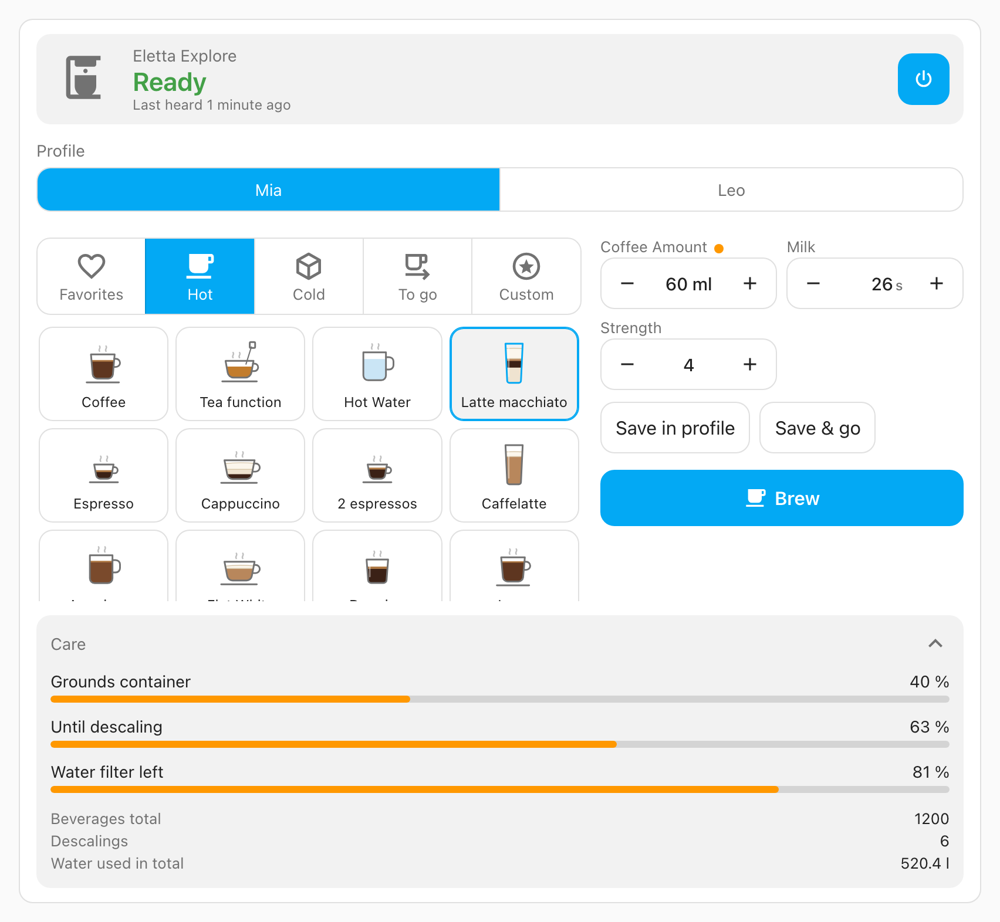
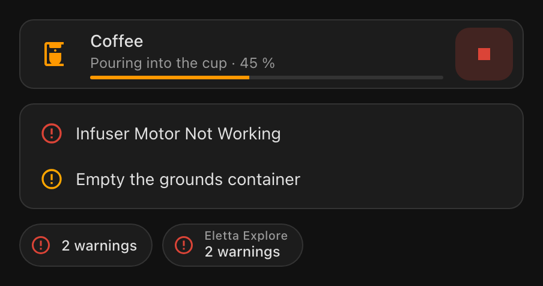
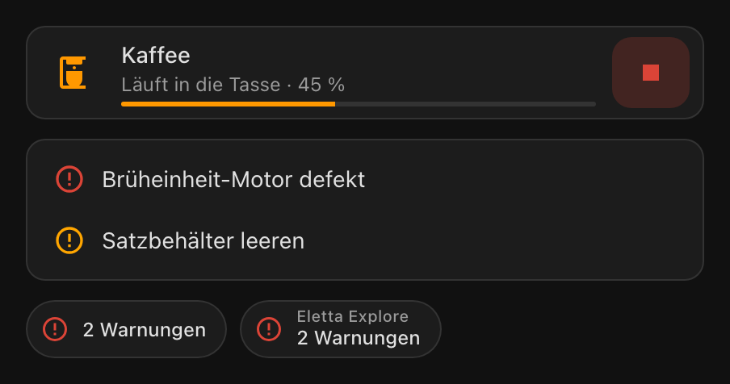
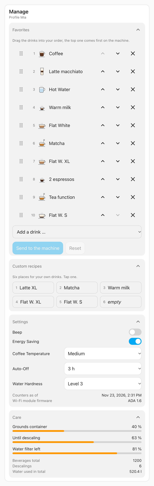
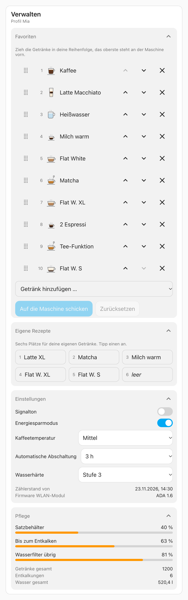

# Cremalink Cards

Lovelace cards for coffee machines set up with the [cremalink-ha](https://github.com/lodzen/cremalink-ha) integration: **Cremalink Coffee Machine** for everyday use (status, drink tiles, sliders with the machine's limits and a brew button), **Cremalink Warnings** (just the warnings, also as a badge) and **Cremalink Machine Manager** for the rarely needed things (favorites, your own recipes, machine settings, maintenance). Colors, fonts and texts follow your Home Assistant theme and language (English and German included). Unofficial; not affiliated with or endorsed by De'Longhi, product names are trademarks of their respective owners.

> [!NOTE]
> Early version. Developed with an Eletta Explore (ECAM452) over the cloud; other machines that cremalink-ha supports should show up too, but are untested.

## Screenshots

| English | Deutsch |
|---|---|
|  |  |
|  |  |
|  |  |

## Cremalink Coffee Machine: what it shows

- **Header:** machine name, status, "last heard x min ago", progress while brewing and a power button.
- **Warnings:** only what needs attention (water tank, grounds container, drip tray, beans, descaling, filter …); faults of the machine in red and first.
- **Drinks:** tabs like the machine and the app have them: **Favorites** (of the active profile), **Hot**, **Cold**, **To go** (with a hot / cold choice below the tabs, as on the machine) and **Custom** (the recipes you named yourself), each with its own icon. One tile per drink, in the order of the machine's drink menu, each with a small picture of the drink in its glass or cup. A custom recipe is drawn like the drink whose picture you chose for it on the machine. Tap a tile to select it.
- **Sliders:** one row for the selected drink (amount, strength, milk, temperature …) with the limits the machine allows. For tea the temperature steps are shown as tea types (white, green, oolong, black). A changed value is marked with a dot and only applies to the next brew; the stored recipe stays untouched.
- **Brew:** one big button. It is disabled while the machine is asleep, busy or still loading the recipe values, and says why. The coffee pot and the cold brew pot can only be set and started on the machine (like in the Coffee Link app): they stay selectable, but have no sliders and no brew button.
- **Profile:** buttons for the profiles you set up (profiles that still have their factory name are left out). Folded below: **Care** (grounds container as a fill level, what is left until descaling and of the water filter, as bars, plus beverages, descalings and water in total). The machine settings live in the Machine Manager card.

## Requirements

- Home Assistant with the cremalink-ha integration (recipe sliders and the brew switch need a version with the recipe panel, `0.3.0b1` or newer).
- The card finds the machine's entities itself. Entities the integration does not provide are left out.

## Installation

**Home Assistant 2026.11 and later (Marketplace):**

1. Add the repository (*Add from link*, `https://github.com/KindOfNerdy/cremalink-card`):

   [](https://my.home-assistant.io/redirect/marketplace_repositories/)

2. Install the card:

   [](https://my.home-assistant.io/redirect/marketplace_repository/?owner=KindOfNerdy&repository=cremalink-card&category=plugin)

**Earlier versions:** add the repository in HACS as a custom repository of type *Dashboard*, then download the card.

[](https://my.home-assistant.io/redirect/hacs_repository/?owner=KindOfNerdy&repository=cremalink-card&category=plugin)

## Usage

Add "Cremalink Coffee Machine" from the card picker and set it up in the visual editor, or use YAML:

```yaml
type: custom:cremalink-card
mode: full   # full | control | status | row | alerts
```

Set `device_id` only if you have more than one machine.

**When the machine sleeps** the card shows only what is useful then: the header with status and power button, warnings and care. Drinks, profile, sliders and the brew button come back once the machine is on. In the Machine Manager the custom recipes are hidden in standby as well (the machine cannot confirm a change then).

**As a single row** (`mode: row`) the card is one line like a tile card, made for a "running now" section: picture, name, status with a thin progress bar while a drink runs, and one button (stop while brewing, otherwise power). Tapping the row opens the status details by default; set `tap_action` (e.g. `navigate` to a pop-up with the full card) and `hold_action` like on any tile card.

**Warnings only** (the "Cremalink Warnings" card in the card picker, `type: custom:cremalink-alerts-card`, or `mode: alerts` of the main card) shows just the machine's warnings, one small line each ("Empty grounds container", "Empty drip tray" …). Tapping a line opens that warning's details by default; `tap_action` and `hold_action` work as for the row. While all is well it hides itself; set `show_ok: true` to keep it and see "All good" instead.

**As a badge** for the top of a sections view, use `custom:cremalink-badge`: one warning by name, several as "2 warnings" (the full list shows on hover). Like the warnings card it is hidden while all is well, unless `show_ok: true`; it takes `device_id`, `hide_alerts`, `tap_action` and `hold_action` too, and `show_name: true` puts the machine's name (or your own `name`) small above the warning like on Home Assistant's entity badges.

```yaml
badges:
  - type: custom:cremalink-badge
    tap_action:
      action: navigate
      navigation_path: "#coffee"
```

Faults of the machine (e.g. a brew unit motor that does not work) are shown in the theme's error color and first, everyday chores (empty the grounds container, refill beans …) in its warning color.

The card adapts to the width it gets on the dashboard: on a wide card the drinks sit next to the sliders and the brew button, on a narrow one everything stacks and shrinks.

## Options

| Option | Default | Description |
|---|---|---|
| `mode` | `full` | `full`, `control` (drinks, sliders, brew), `status` (header, warnings, maintenance), `row` (one line like a tile card) or `alerts` (only the warnings, one line each) |
| `hide` | – | Sections to hide: `header`, `recipes`, `sliders`, `save` (the save buttons below the sliders: changes then only apply to the next brew), `profile`, `alarms`, `maintenance` |
| `name` | device name | Title in the header |
| `device_id` | first machine | Device of the machine |
| `tap_action` | `more-info` | `row` and `alerts` only: what tapping a line does (Home Assistant action: `more-info`, `navigate`, `url`, `perform-action`, `none`) |
| `hold_action` | `none` | `row` and `alerts` only: what holding a line does |
| `show_ok` | `false` | `alerts` only: stay visible without a warning and say "All good" |
| `hide_alerts` | – | Warnings never to show (list of the machine's warning entities), in the warnings section, the warnings card and the badge |
| `tabs` | all | Tabs to show, e.g. `[favorites, hot, custom]` (`favorites`, `hot`, `cold`, `togo`, `custom`); they keep the machine's order |
| `drink_icons` | `false` | Simple icons instead of the drink pictures (also in the Machine Manager) |
| `tab_labels` | `true` | Show the text under the tab icons; `false` shows the icons only |
| `show_default_profiles` | `false` | Also show profiles that still have their factory name ("Explorer 2" …) |
| `drinks` | all | YAML only: list of drink keys to show, e.g. `[espresso, cappuccino, tea]` |
| `images.device` | – | URL of a picture of your machine |
| `images.tabs` | – | URL pattern for the tab pictures, `{tab}` is `favorites`, `hot`, `cold`, `togo` or `custom`, e.g. `/local/coffee/tab_{tab}.webp` |
| `images.drinks` | – | Your own drink pictures: URL pattern, `{drink}` is the drink key, e.g. `/local/coffee/{drink}.webp` (see Pictures) |

The tabs use the drink ids and the favorites from the integration where it provides them (`option_beverages` and `favorite_beverages` attributes of the recipe select) and the drink's name otherwise.

### Pictures

The drink tiles show the card's own pictures: each drink in its glass or cup with its typical layers (espresso, milk, foam, ice …). The vessel takes your theme's icon color (the primary color once selected), the drink inside natural colors, so they fit light and dark themes alike. `drink_icons: true` switches to simple icons.

**Your own pictures** replace them drink by drink:

1. Put one picture per drink into your `www` folder, e.g. `config/www/coffee/latte_macchiato.webp`. Square pictures with a transparent background, about 96 × 96 px, work best (PNG, WebP or SVG).
2. Name each file after the drink key: the option of the machine's recipe select, as Home Assistant lists it in the entity's attributes (`espresso`, `latte_macchiato`, `mug_flat_white` …). A custom recipe uses the key of the drink its picture stands for (a recipe shown as a latte macchiato on the machine uses `latte_macchiato`).
3. Point the card at the folder, with `{drink}` where the key goes:

```yaml
images:
  drinks: /local/coffee/{drink}.webp
  device: /local/coffee/machine.webp      # optional: your machine in the header
  tabs: /local/coffee/tab_{tab}.webp      # optional: favorites, hot, cold, togo, custom
```

A drink without a file keeps the built-in picture, so you can replace just a few. Files in `www` are cached by the browser; after changing a picture, reload the page.

### Saving changed values

If you change values with the sliders, two buttons appear below them, like *save* in the Coffee Link app: *Save in profile* (standard drinks) or *Save in recipe* (your own recipes), and *Save and brew*. The brew button keeps brewing the changed values once, without saving. For cold and cold to-go drinks the machine keeps the coffee, milk and water amounts fixed, so only their other values can be saved. `hide: [save]` leaves the buttons out.

## Cremalink Machine Manager

The second card, for things you rarely change. Add "Cremalink Machine Manager" from the card picker, or use YAML:

```yaml
type: custom:cremalink-admin-card
```

It holds four sections. Each one can be folded; they are open at first and the card remembers what you folded (per browser, separately from the Coffee Machine card):

- **Favorites** of the active profile: drag the grip to reorder (the arrow buttons work too), remove drinks, add drinks from the list (at most 12), then *Save on machine*. This needs a machine that is awake.
- **Custom recipes**: the machine's six places for your own drinks. Pick a place to create or change a recipe like in the Coffee Link app: name, the picture shown on the machine (the app's 20 pictures, plus the machine's further ones), and the ingredients coffee (with strength), milk (with froth and milk first) and hot water within the place's limits. The form opens with what the machine holds now. Then *Only save*, *Save and brew* or *Delete* (asks twice). Hidden while the machine is in standby.
- **Machine settings:** beep, energy saving, coffee temperature, auto-off, water hardness, plus when the counters were last updated and the Wi-Fi module firmware.
- **Care:** the same bars and counters as in the Coffee Machine card.

| Option | Default | Description |
|---|---|---|
| `hide` | – | What to hide: `title`, `favorites`, `custom`, `settings`, `maintenance` |
| `sections` | all | YAML only: which sections to show and in what order, e.g. `[maintenance, favorites]` |
| `name` | device name | Title of the card |
| `device_id` | first machine | Device of the machine |

You can arrange the sections like separate cards: add the Machine Manager several times, each with one section and without the title, and place them wherever you like on the dashboard.

```yaml
type: custom:cremalink-admin-card
hide: [title]
sections: [settings]
```

## Support

If this saves you time, you can [buy me a coffee on Ko-fi](https://ko-fi.com/kindofnerdy) ☕
